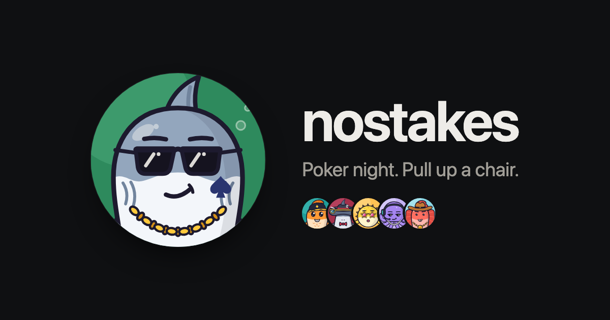

<p align="center">
  
</p>

# nostakes

Poker night with your friends, in the browser.

One person opens a room and drops the link in the group chat. Up to nine friends join, build a face, sit down, and play no-limit hold'em. When the night ends, nostakes says who pays whom.

It should feel like sitting in the same room, not like an online casino. There are no accounts, no ads, and no real money: the app keeps the count, and friends settle up outside it.

> Pre-release. [nostakes.club](https://nostakes.club) is not live yet.

## What it does

- **A room is a link.** No sign-up and nothing to install. A closed tab or a sleeping phone puts you back in your seat.
- **Your friends' faces are the table.** Hold your cards to peek, tap the chip to call, drag it to raise, flick your cards away to fold. Faces look down at their cards, think, and react.
- **It plays the way your group plays.** Antes, straddles, running it more than once, rabbit hunts, bomb pots, a seven-deuce bounty, showing one card. Everything outside core hold'em is a host setting.
- **The chips are exact.** Every chip is an integer and is accounted for after every hand.
- **The deck can be checked.** Each hand's deck is sealed before its order is known, the order comes from a public randomness beacon, and every player's device verifies the cards it was shown.
- **Settling up is one glance.** Each player's net for the night and the fewest transfers that square everyone, as a picture for the group chat.
- **Hands worth talking about get kept.** A bad beat or a bluff becomes a picture or a short clip, made on your own device.
- **New to poker?** A guide teaches the game in five short hands.

## How it is built

- **Pure cores with no I/O.** `engine` holds the rules of a hand, `ledger` the money across a night, `room` one poker night as a reducer, and `shuffle` the sealed deck and its proofs. Commands go in, events come out, and state is rebuilt from events.
- **Checked against an independent implementation.** The rules are compared with [PokerKit](https://pypi.org/project/pokerkit/) hand for hand, and bots play whole nights on every push.
- **One Cloudflare Durable Object per room.** It hosts the room core, stores its event log, and speaks a small protocol over one WebSocket. Infrastructure is declared with [Alchemy](https://alchemy.run).
- **A headless client and a [Foldkit](https://github.com/foldkit/foldkit) web app.** The client holds the connection and resumes after a drop without missing or repeating an event.
- **[Effect](https://effect.website) throughout**, behind a type and lint fence that makes the easy path the right one. The conventions come from [rat-stack](https://ratstack.sh).

[`VISION.md`](VISION.md) says what the product is for. [`packages/shuffle/DESIGN.md`](packages/shuffle/DESIGN.md) holds the fair shuffle's threat model, including what it does not prove.

## Run it locally

You need Node 24.22.1 or later and pnpm.

```sh
pnpm install
pnpm dev
```

Open `http://localhost:5173`, open a room, and join it from a private window to play a hand against yourself. Nothing is deployed and no Cloudflare account is needed.

## Documentation

- [`docs/development.md`](docs/development.md): setup, playing locally, the checks, and every command
- [`docs/deploying.md`](docs/deploying.md): the stages, credentials, deploys, and rolling back
- [`AGENTS.md`](AGENTS.md): the rules for changing code here. Read it before you change anything.
- [`PROVENANCE.md`](PROVENANCE.md): credit for borrowed code, fonts, and data

## License

nostakes is free software under the [GNU Affero General Public License, version 3](LICENSE). You may use, change, and host it. If you run a changed version as a service, you must offer its source to the people who use it.

Copyright (C) 2026 Shoubhit Dash.

The nostakes name and logo are not covered by that licence. A changed copy needs its own name.

Third-party code and fonts keep their own licences, listed in [`PROVENANCE.md`](PROVENANCE.md).
